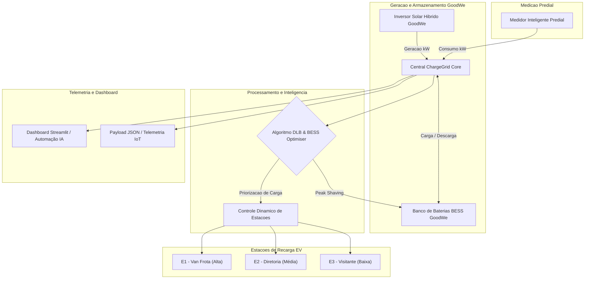

# ChargeGrid Intelligence - Solução Final Integrada e Inovadora
> FIAP - Challenge GoodWe 2026 | Sprint 4: Entrega Final Integrada

---

## Equipe Envolvida (Grupo 03)
* Pedro Andreassa - RM: 569318
* Pedro Yoshikado - RM: 570449
* Rafael Ferreirinha - RM: 571949
* Thiago Maluf - RM: 569852

---

## 1. Visão Geral e Alinhamento ao Desafio GoodWe
O ChargeGrid Intelligence é uma solução integrada de automação energética, microredes inteligentes e gestão de carregamento para veículos elétricos (EV).

Na Sprint 4, o sistema integra o ecossistema GoodWe completo: geração fotovoltaica com inversores híbridos, armazenamento de energia em baterias estacionárias (BESS), sistema de balanceamento dinâmico de carga (DLB) e assistente de automação com métricas de impacto socioambiental (redução de pegada de carbono e economia financeira).

---

## 2. Esquema Arquitetural e Integração dos Componentes

O fluxo de dados conecta a geração solar, o banco de baterias GoodWe, a medição do edifício e as estações de recarga:



---

## Principais Inivações e Diferencias da Solução

1. **Uso de Armazenamento BESS (GoodWe Peak Shaving)**: No Horário de Pico, o sistema utiliza a energia armazenada nas baterias para suprir o consumo predial antes de desativar os carregadores de veículos.
2. **Dynamic Load Balacing (DLB) por Prioridades**: Atuação progressiva que preserva frotas comerciais essenciais e limita estações secundárias.
3. **Métricas de Impacto Ambiental**: Cálculo em tempo real da redução da pegada de carbono (kgCO2 evitado) e economia financeira gerada.
4. **Assistente de Automação Inteligente**: Recomendações automáticas com base na hora do dia e disponibilidade solar/bateria.

---

## Resultados Quantitativos e Qualitativos

- Eficiência Energética: Redução de até 100% das multas por ultrapassagem de demanda contratada em horários de pico.
- Redução de Pegada de Carbono: Cada kWh solar consumido no ecossistema evita em média 0,084 kgCO2 na matriz elétrica nacional.
- Viabilidade Técnica: Execução leve, modular e compatível com gateways de comunicação corporativos e protocolo OCPP.

---

## Como Executar a Solução Final

1. Clonar o Repositório

```bash
git clone https://github.com/pedroyoshikadogarcia/Fiap-GoodWe-Chargegrid-Sprint1-2-3-4-Grupo-03.git
cd Fiap-GoodWe-Chargegrid-Sprint1-2-3-4-Grupo-03
```

2. Instalar as Dependências

```bash
pip install streamlit pandas altair
```

3. Executar o Dashboard Integrado

```bash
python -m streamlit run poc_chargegrid.py
```
